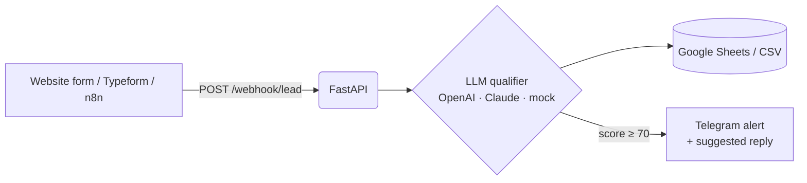

# AI Lead Qualifier

Inbound leads from your website form are scored by an LLM, saved to Google Sheets / CSV, and the hot ones land in Telegram within seconds, together with a ready-to-send first reply.

**Problem it solves:** sales teams waste hours reading every form submission and reply to good leads too late. This service reads each lead, figures out what the client wants, estimates budget and urgency, and pings you only when it matters.



## Features

- **Structured LLM output** validated with Pydantic: category, budget in USD, urgency 1–5, score 0–100, priority, summary, suggested reply
- **Retries with self-correction**: if the model returns invalid JSON, the error is fed back and it tries again
- **Pluggable providers**: OpenAI, Anthropic Claude, or a keyword-based **mock mode that runs without any API key**
- **Pluggable storage**: CSV out of the box, Google Sheets via service account
- **Telegram alerts** for hot leads, HTML-escaped, never blocking lead storage if Telegram is down
- **Webhook secret** header for production use
- Docker + docker-compose, tests with pytest

## Quick start (no API keys needed)

```bash
pip install -r requirements-dev.txt
cp .env.example .env

# run the pipeline on 5 sample leads
python -m app.cli scripts/sample_leads.json
```

Output:

```
Provider: mock

PRIORITY SCORE  CATEGORY          BUDGET  LEAD
hot        100  automation        $3,000  Mark Jensen (Nordic Parts ApS)
hot         95  ai_integration    $1,500  Priya Shah (Bright Dental)
cold        20  web_scraping         $50  Alex (-)
hot         95  backend_api       $3,000  Lena Weber (Urban Loft Immobilien)
cold         5  other                  —  Tom (-)

Saved to data/leads.csv
```

Telegram alert for a hot lead:

```
🔥 HOT lead — score 100/100
Mark Jensen · Nordic Parts ApS
📧 mark@nordicparts.dk
🏷 automation · 💰 $3,000 · ⏱ urgency 5/5

Automation request from Nordic Parts ApS, budget ~$3,000

Suggested reply:
Hi Mark, thanks for reaching out! Your automation task sounds like a great fit. ...
```

## Run as a webhook service

```bash
uvicorn app.main:app --reload
# or
docker compose up --build

python scripts/send_sample_leads.py http://localhost:8000
```

```bash
curl -X POST http://localhost:8000/webhook/lead \
  -H "Content-Type: application/json" \
  -d '{"name":"Anna","email":"anna@shop.com","company":"Shop","message":"Need a GPT chatbot for support","budget":"$2k"}'
```

Interactive API docs: http://localhost:8000/docs

## Use a real LLM

```env
LLM_PROVIDER=openai          # or anthropic
OPENAI_API_KEY=sk-...
```

## Google Sheets & Telegram

1. Create a Google Cloud service account, download its JSON key, share your sheet with the service account email.
2. Set `GOOGLE_SHEET_ID` and `GOOGLE_CREDENTIALS_FILE` in `.env`.
3. Create a bot with [@BotFather](https://t.me/BotFather), set `TELEGRAM_BOT_TOKEN` and your `TELEGRAM_CHAT_ID`.

## Project structure

```
app/
  models.py      Lead and Qualification schemas
  qualifier.py   Mock / OpenAI / Anthropic qualifiers with retry + validation
  pipeline.py    qualify -> store -> alert
  sinks.py       CSV and Google Sheets storage
  notifier.py    Telegram alerts
  main.py        FastAPI webhook
  cli.py         run on a JSON file
tests/           pytest suite
```

## Tests

```bash
pytest -q
```

## Stack

Python 3.12 · FastAPI · Pydantic v2 · OpenAI / Anthropic SDK · gspread · Telegram Bot API · Docker

---

Built by [Olesia Tkachenko](https://lessiatk.github.io) — Python & AI automation. Need something similar? [Get in touch](mailto:olesiatkachenko211@gmail.com).
